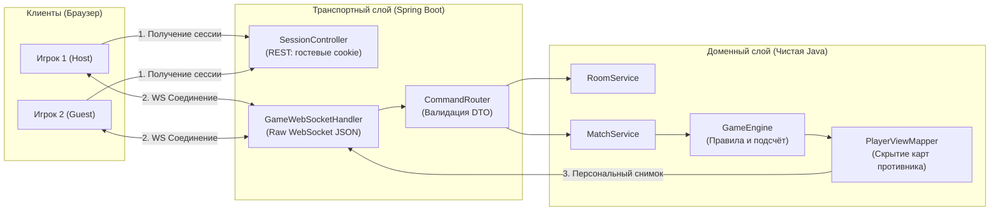

# ⚔️ «Северные хроники» (Northern Chronicles)

> **Браузерная сетевая пошаговая карточная игра по мотивам механик «Гвинта» из «The Witcher 3».**  
> Проект разработан в рамках университетского проектного практикума с разделением на авторитетный сервер на **Java 27 / Spring Boot** и адаптивный клиент на **чистых ES-модулях**.

[](https://github.com/OWNER/REPO/actions/workflows/ci.yml)


---

## 🎯 О проекте

«Северные хроники» — это тактическая дуэльная карточная игра для двух участников, цель которой — победить соперника в двух раундах из трёх за счёт грамотного планирования ресурсов, блефа и контроля поля.

В проекте реализованы **два полноценных режима работы**:
1. **🎮 Локальный режим (Тренировка с ботом):** работает автономно в браузере через встроенную локальную симуляцию правил без необходимости запуска бэкенда.
2. **🌐 Сетевой PvP-режим:** полноценный мультиплеер по комнатам через **WebSocket** с авторитетным сервером, контролирующим правила и скрывающим руку оппонента («туман войны»).

<!-- 
Скриншот игрового процесса:
Добавьте изображение в docs/assets/screenshot.png и раскомментируйте строку ниже
 
-->

---

## 🌟 Ключевые особенности и технические решения

* **🛡️ Авторитетный сервер (Authoritative Server):**
  Браузер не принимает игровых решений и не вычисляет счёт. Клиент передаёт исключительно намерение (`PLAY_CARD`, `PASS`). Сервер верифицирует легальность хода, вычисляет модификаторы и рассылает актуальные снимки состояния.
* **🕵️ «Туман войны» (Data Projection & Security):**
  Сервер генерирует персонализированную проекцию (`GameView`) для каждого игрока: рука соперника, порядок карт в колоде и скрытые данные никогда не попадают в сеть, что полностью исключает инспекцию через DevTools.
* **⚡ Легковесный и быстрый Frontend:**
  Разработан на нативных веб-стандартах: **Vanilla JavaScript (ES-модули)** и адаптивном CSS без тяжелых SPA-фреймворков и сборщиков. Все 14 определений карт оформлены с помощью компактной процедурной векторной графики (**SVG**), не требующей загрузки растровых ассетов.
* **🧩 Чистая архитектура бэкенда (Clean Architecture & DDD):**
  Доменная модель игры построена на неизменяемых Java `record` (copy-on-write) и полностью изолирована от Spring Framework, WebSocket и базы данных.
* **🔄 Надёжный транспорт:**
  Сетевой протокол реализован поверх нативного WebSocket с защитой от рассинхронизации ревизий (`revision`), контролем повторных ходов и механизмом переподключения (`RESUME`).

---

## 🏗 Архитектура системы



---

## 🚀 Быстрый запуск

### Вариант 1. Локальная игра с ботом (запуск за 10 секунд)
Для запуска демонстрационного режима с ботом требуется только **Node.js 20+** (сторонних зависимостей нет, `npm install` не нужен):

```bash
# Запуск легковесного сервера статики
npm start
```
Откройте браузер по адресу: **`http://localhost:5173`**.

---

### Вариант 2. Полный сетевой запуск (Frontend + Java Backend)

#### Шаг 1. Запуск игрового сервера
Требуется **JDK 27+**:
```bash
cd backend

# Windows:
.\mvnw.cmd spring-boot:run

# Linux / macOS:
./mvnw spring-boot:run
```
Сервер запустится на порту `8080` (REST & WebSocket).

#### Шаг 2. Запуск клиентского интерфейса
В отдельном терминале из корня проекта:
```bash
npm start
```

#### Шаг 3. Сетевая дуэль двух игроков
1. Откройте **`http://localhost:5173`** в первом окне (Игрок 1).
2. Откройте **`http://localhost:5173`** во втором окне в режиме **Инкогнито** (Игрок 2, чтобы разделить гостевые cookie сессии).
3. В правом верхнем меню нажмите кнопку переключения режима с «Локальный бот» на сетевой сервер (`ws://localhost:8080/ws`).
4. Игрок 1 создаёт комнату и сообщает сгенерированный 6-значный код комнаты Игроку 2.
5. Игрок 2 вводит код комнаты и подключается к дуэли.

---

## 🧪 Тестирование и контроль качества

В проекте настроен автоматический запуск тестов для обеих частей системы:

### Тесты интерфейса и клиентского транспорта
```bash
# Проверка синтаксиса JS файлов
npm run check

# Запуск тестов правил и WebSocket-транспорта (включает стресс-тест на 100 партий бота)
npm test
```

### Тесты бэкенда (JUnit 5)
```bash
cd backend
# Windows:
.\mvnw.cmd test

# Linux / macOS:
./mvnw test
```

В репозиторий встроен **GitHub Actions CI**, автоматически запускающий сборку и все наборы тестов при каждом Pull Request.

---

## 📂 Структура репозитория

```text
northern-chronicles/
├── .github/
│   ├── workflows/ci.yml       # Спецификация CI/CD (GitHub Actions)
│   └── pull_request_template.md # Регламент оформления Pull Request
├── frontend/                  # Клиентская часть
│   ├── index.html             # Точка входа SPA
│   ├── assets/                # Векторная графика (герб, иконки)
│   └── src/
│       ├── app.js             # Управление UI, обработка пользовательских событий
│       ├── styles.css         # Адаптивные стили (CSS Grid / Flexbox)
│       ├── cards.js           # Описания карт и колода
│       ├── game.js            # Локальный движок правил для игры с ботом
│       └── transport.js       # Адаптеры DemoTransport и WebSocketTransport
├── backend/                   # Серверная часть (Java 27 / Spring Boot 3)
│   ├── pom.xml                # Конфигурация сборки Maven
│   └── src/main/java/         # Доменная модель, правила, контроллеры и WS-хэндлеры
├── docs/                      # Подробная проектная документация
│   ├── ARCHITECTURE.md        # Архитектурные принципы, слои и инварианты
│   ├── PROTOCOL.md            # Спецификация сетевого протокола DTO / WebSocket
│   ├── TESTING.md             # Сценарии ручной и автоматической верификации
│   ├── BACKEND_TODO.md        # Дорожная карта разработки сервера
│   └── plans/                 # Детальные поэтапные планы реализации
├── tests/                     # Автоматические тесты фронтенда (node:test)
└── tools/                     # Утилиты разработки (сервер статики serve.mjs)
```

---

## 📚 Документация проекта

Подробные спецификации и технические руководства находятся в директории [`docs/`](docs/):
* 📐 **[Архитектура системы и правила игры](docs/ARCHITECTURE.md)** — доменные сущности, фазы раундов, математика подсчёта очков.
* 📡 **[Сетевой протокол (PROTOCOL.md)](docs/PROTOCOL.md)** — JSON-контракты запросов, ответов, ошибок и форматов снимков (`GameView`).
* 📋 **[Тестирование (TESTING.md)](docs/TESTING.md)** — чек-листы проверок и методология верификации.
* 🗺 **[Планы реализации этапов](docs/plans/)** — дорожные карты и решения проектного практикума.

---

## 👥 Команда проекта

| Участник | Роль в проекте | Основные зоны ответственности |
|---|---|---|
| **Имя Фамилия** | Backend Lead / Архитектор | Разработка доменного ядра, валидация инвариантов, бизнес-логика раундов |
| **Имя Фамилия** | Backend & Network Engineer | Реализация WebSocket-хэндлеров, сессий, маршрутизации DTO и синхронизации |
| **Имя Фамилия** | Frontend & UI/UX Developer | Реализация игрового экрана, анимаций, адаптивности и интеграция транспорта |
| **Имя Фамилия** | QA & DevOps Engineer | Настройка CI/CD, модульные и интеграционные тесты, Docker-окружение |

---

## 📄 Лицензия

Проект разработан исключительно в учебных целях в рамках университетского проектного практикума. Исходный код распространяется под лицензией [MIT](LICENSE).
