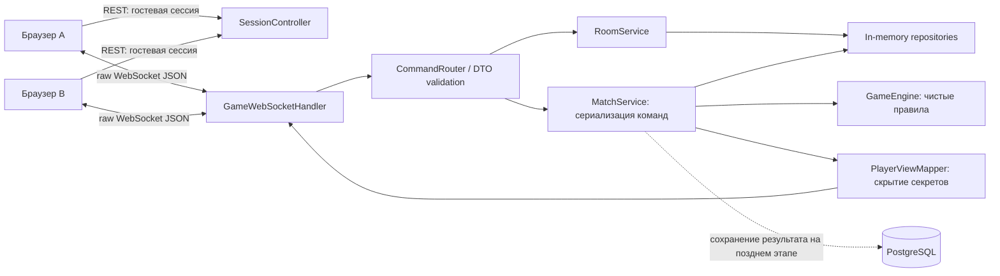
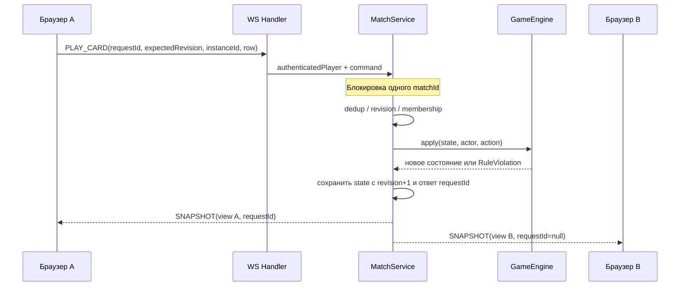

# Архитектура и логика проекта

## 1. Цель и границы

Цель практикума — разобраться с Java, предметной моделью, WebSocket, серверными проверками и конкурентным доступом на примере пошаговой игры для двух пользователей. Первый результат: два браузера входят в одну комнату и честно доигрывают матч. Начните с одного Java-процесса и хранения активных игр в памяти. Микросервисы, Redis, брокер сообщений и Kubernetes для этого этапа не нужны.

Готовая часть проекта — frontend с отдельным локальным симулятором. Будущая Java-часть должна быть **авторитетным источником состояния**: клиент сообщает намерение, сервер проверяет его и присылает новое состояние. Нельзя принимать от браузера готовую силу ряда, изменённую руку, имя победителя или identity игрока.

Упрощённые правила ниже — спецификация именно этого проекта. Заимствование всей логики оригинального Гвинта не предполагается.

## 2. Схема компонентов



Frontend содержит экраны и действия в `app.js`, каталог в `cards.js`, демонстрационный движок в `game.js`, два взаимозаменяемых транспорта в `transport.js`. Оба транспорта вызывают один callback `onUpdate({view, room, status, pending})`. UI отправляет `send(type, payload)` и не знает, где исполняются команды.

В demo-режиме `DemoTransport` применяет чистую JS-функцию и планирует ответ бота. В online-режиме `WebSocketTransport` отправляет JSON и заменяет локальную проекцию серверным снимком. Совместимые названия cardId и enum критичны: неизвестный каталог отклоняется сетевой проверкой.

## 3. Предлагаемая Java-структура

```text
backend/
├── pom.xml
├── src/main/java/ru/practicum/chronicles/
│   ├── ChroniclesApplication.java
│   ├── config/             WebSocketConfig, SecurityConfig, CorsConfig
│   ├── transport/
│   │   ├── http/           SessionController
│   │   ├── ws/             GameWebSocketHandler, SessionRegistry, OutboundSender
│   │   └── dto/            ClientCommand, ServerEnvelope, GameView, ErrorPayload
│   ├── application/        RoomService, MatchService, CommandRouter, GuestSessionService
│   ├── domain/
│   │   ├── model/          MatchState, PlayerState, CardDefinition, CardInstance, Row
│   │   ├── rules/          GameEngine, ScoreCalculator, DeckValidator
│   │   └── error/          RuleViolation, ErrorCode
│   ├── projection/         PlayerViewMapper
│   └── infrastructure/
│       ├── memory/         InMemoryRoomRepository, InMemoryMatchRepository
│       ├── persistence/    MatchResultEntity, JpaMatchResultRepository (позже)
│       └── catalog/        JsonCardCatalog
├── src/main/resources/     application.yml, cards.json, db/migration/ (позже)
└── src/test/java/           domain/, application/, transport/, projection/
```

Это один Maven-модуль с логическими пакетами. `domain` не импортирует Spring, WebSocket, Jackson и JPA. `transport` занимается преобразованием JSON и соединениями, `application` — сценарием и порядком операций, `domain` — правилами, `infrastructure` — конкретным хранением. DTO не должны быть JPA-сущностями или самим `MatchState`.

Предлагаемые методы, которые вы реализуете сами:

```java
MatchState GameEngine.start(List<PlayerId> players, Decks decks, RandomGenerator rng);
MatchState GameEngine.apply(MatchState state, PlayerId actor, GameAction action);
int ScoreCalculator.rowScore(MatchState state, PlayerId player, Row row);
GameView PlayerViewMapper.forPlayer(MatchState state, PlayerId viewer);
void MatchService.handle(AuthenticatedPlayer actor, ClientCommand command);
```

На старте предпочтительна модель с копированием состояния: создаёте кандидат, проверяете, применяете, затем атомарно заменяете. Если выбираете mutable-модель, гарантируйте, что неуспешная команда не оставит частично удалённую карту или изменённую жизнь. Не смешивайте два подхода.

## 4. Предметная модель

| Объект | Поля и смысл |
|---|---|
| CardDefinition | cardId, name, type, row, power, hero; неизменяемый шаблон карты |
| CardInstance | instanceId, cardId; конкретная копия, уникальная внутри матча |
| Deck | упорядоченные скрытые экземпляры; с фронтенда не принимается |
| PlayerState | playerId, name, lives, hand, deck, discard, board, horns, passed |
| MatchState | matchId, revision, phase, round, starterId, activePlayerId, players, weather, ready, roundResults, winnerId, log |
| Room | roomId, code, ownerId, participantIds, status, matchId, expiresAt |
| GuestSession | случайный идентификатор сессии → playerId, nickname; cookie хранит сессию, не доверенный playerId |
| RoundResult | round, scores в порядке players, winnerId или null |

`CardType`: UNIT, WEATHER, CLEAR, HORN. `Row`: MELEE, RANGED, SIEGE. `MatchPhase`: PLAYING, ROUND_OVER, MATCH_OVER. `RoomStatus`: WAITING, PLAYING, CLOSED. Состояние соединения — отдельное понятие, не фаза матча.

Внутренние Java-поля могут называться иначе, но JSON обязан совпадать с `PROTOCOL.md`. Используйте record для небольших значений/DTO, enum для конечных наборов. Коллекции состояния не отдавайте наружу как изменяемые ссылки.

## 5. Полные правила MVP

### Колода и старт

Фиксированная колода для обеих фракций одинаковая: по 3 копии восьми обычных типов бойцов, 1 герой и 5 специальных карт (мороз, туман, дождь, ясное небо, рог). Всего 30 карт, из них 25 бойцов. Источник точных cardId, силы и рядов — `frontend/src/cards.js`. Сервер должен иметь собственный проверенный каталог с теми же значениями.

У каждого игрока 2 жизни. Сервер отдельно перемешивает обе колоды Fisher–Yates, выдаёт по 10 карт, остальные 20 сохраняет в скрытой колоде. В demo начинает пользователь; в online первого игрока выбирает сервер случайно, сообщает activePlayerId и сохраняет starterId. Пересдачи и добора в текущей версии нет. Фракционные названия декоративные.

### Ход

Игрок, указанный в activePlayerId, выбирает одно действие: PLAY_CARD или PASS. Команда проверяется в таком порядке: сессия → принадлежность матчу → дедупликация requestId → expectedRevision → фаза → очередь → passed → владение экземпляром → тип/цель/эффект. Конкретное сообщение об ошибке не должно раскрывать чужую руку.

UNIT перемещается из руки в свой фиксированный ряд. HORN перемещается в список horns своего выбранного ряда; второго рога в том же ряду быть не может. WEATHER добавляет свой row в общую погоду и сразу уходит в discard владельца. CLEAR очищает все погодные эффекты и тоже сразу уходит в discard. Снять отсутствующую погоду и повторить уже активный погодный row нельзя; ошибка не расходует карту и ход. Спецкарта тоже занимает весь ход. Рог допустим на пустом своём ряду.

После успешного действия при пустой руке игрок автоматически получает passed=true. Если обе стороны спасовали — завершить раунд. Иначе ход переходит к сопернику, если тот не спасовал; если спасовал, ход остаётся у текущего игрока. После PASS нельзя снова играть в этом раунде.

### Подсчёт силы

Для обычного бойца:

```text
base = weather содержит row ? 1 : card.power
effective = base × (в своём ряду есть horn ? 2 : 1)
```

Герой всегда имеет силу 10, без погоды и усиления. Сила ряда — сумма effective всех бойцов. Сила стороны — сумма трёх рядов. Пример: обычные бойцы 4 и 6 плюс герой 10 дают 20; под морозом 12; под морозом и рогом 14; после ясного неба при сохранённом роге 30. Погода действует на обе стороны, рог — только на своего владельца и выбранный ряд.

В Java пересчитывайте силу из состояния. Не храните независимые изменяемые totalScore и rowScore, пока не доказали необходимость кэша. Frontend выводит очки по той же формуле, но ему нельзя доверять как арбитру.

### Завершение раунда и матча

Два паса запускают однократное сравнение силы. При неравенстве проигравший теряет 1 жизнь. При равенстве обе стороны теряют по 1. Сначала примените потери ко всем, затем вычислите результат матча: один игрок с нулём — проиграл; оба с нулём — ничья. `winnerId=null` означает ничью только вместе с MATCH_OVER или соответствующим RoundResult; до финала это также незаданный победитель.

Если все живы, фаза ROUND_OVER. Старое поле остаётся видимым для оценки результата. Оба игрока посылают READY_NEXT_ROUND по одному разу; один готовый игрок ещё не начинает раунд. После второй готовности все обычные карты и герои с поля и рога уходят в discard владельцев, погода очищается, ready обнуляется, round увеличивается. Руки не меняются, добора нет.

Следующий раунд начинает проигравший предыдущего. При ничьей starterId переключается на другую сторону. Если у выбранного игрока пустая рука, он уже спасовал, ход получает второй. Если пусты обе руки, новый раунд сразу оценивается как 0:0, и матч заканчивается при последней жизни. Реализуйте переход так, чтобы не зависнуть без activePlayerId.

Матч длится максимум три раунда. MATCH_OVER не принимает игровые команды. Для MVP новый сетевой матч после завершения создаётся в новой гостевой комнате через новое подключение; кнопки rematch в текущем frontend нет.

## 6. Последовательность сетевого хода



Публикуйте снимки в порядке revision. Даже при разных сокетах один матч изменяется последовательно. При реализации с lock удобно поставить готовые сообщения в очередь отправки под тем же lock, затем отправить неблокирующим сериализованным sender. Нельзя сначала освободить lock, а затем независимо формировать или отправлять снимки так, чтобы новая ревизия обогнала старую.

## 7. Конкурентность и идемпотентность

WebSocket не решает гонки между потоками Java. `ConcurrentHashMap<MatchId, MatchState>` защищает карту, но не составную операцию «проверить → применить → сохранить». Используйте per-match lock или последовательную очередь команд. Для комнаты отдельно атомарно проверяйте свободное место и присоединяйте второго игрока, чтобы не пустить третьего и не создать два матча.

`revision` увеличивается на 1 за каждую принятую изменяющую команду, включая первую готовность к следующему раунду. Ошибки и RESUME её не меняют. После повторного requestId нельзя применять действие второй раз. Храните ограниченный кеш по `(playerId, requestId)` с fingerprint команды и исходным результатом. Тот же requestId с другим содержимым — REQUEST_ID_REUSE. Дубликат с тем же содержимым обрабатывайте **до** проверки expectedRevision: его старый revision ожидаем и не означает новый ход. При повторе можно отправить текущий безопасный снимок с тем же requestId, без новой мутации; это позволяет восстановить состояние после потери ответа.

Два READY_NEXT_ROUND могут прийти с одним expectedRevision. Первый принимается, второй получает STALE_REVISION и актуальный снимок; после него пользователь повторяет готовность. Это осознанная простая семантика MVP, без автоматического повтора команды клиентом.

Для одного WebSocketSession сериализуйте outbound-send (например, очередь или ConcurrentWebSocketSessionDecorator). Отдельно ограничивайте размер очереди и время отправки: медленный клиент не должен блокировать матч.

## 8. Сессии, скрытая информация и соединение

POST `/api/session` создаёт гостя либо возвращает существующего из cookie. Если игрок уже в матче, смена nickname не должна менять identity. Cookie — HttpOnly; для локального HTTP возможен SameSite=Lax без Secure, для HTTPS включите Secure. WebSocket-handshake получает существующую сессию, неизвестная сессия отклоняется. В клиентском JSON нет playerId. Проверяйте Origin в handshake, а для REST разрешайте только нужные origins и credentials. Для размещения предпочтительнее один origin через reverse proxy: межсайтовые cookies браузер может блокировать.

Никогда не сериализуйте MatchState напрямую. `PlayerViewMapper` формирует две разные проекции: своя hand, чужая только handCount, обе стороны с открытым полем и общими эффектами, deck только как счётчик. В log нельзя писать названия добранных/скрытых карт. Каталог открытый, порядок колоды скрытый. Unit-тесты должны проверять отсутствие полей hand/deck у противника во всех видах событий, а не только скрытие CSS.

Клиент блокирует отправку до ответа, не меняет поле заранее, при потере связи блокирует ходы. На переподключении создаёт новый сокет с той же cookie и посылает RESUME. Не проигрывайте неподтверждённую команду повторно: она могла уже примениться. Сервер проверяет принадлежность matchId и возвращает текущую персональную проекцию.

Текущий клиент делает до пяти попыток переподключения с задержками 1/2/4/8/16 секунд и небольшим jitter. Матч/комната помнятся только в памяти страницы. На сервере разумно начать с 90 секунд grace period; новая сессия сокета отменяет только актуальный таймер ухода. По истечении срока отключившийся получает техническое поражение, если второй игрок ещё подключён. Если оба отсутствуют, закройте матч как abandoned с winnerId=null и отдельной серверной причиной. Для первой интеграции достаточно восстановления без таймера; технические исходы добавляйте после основных правил и документируйте отдельно.

Выберите политику нескольких вкладок одного игрока: для MVP один активный сокет, новый заменяет старый. Старый onClose не должен удалить регистрацию нового. Для двух игроков используйте разные браузерные профили.

## 9. Хранение и инфраструктура

Этап A: RoomRepository/MatchRepository в памяти. Перезапуск сервера теряет партии, это явно допустимое ограничение учебного MVP. GuestSession также можно держать в HTTP session.

Этап B: PostgreSQL сохраняет только завершённые результаты и, позднее, пользовательские колоды. Таблицы: `players(id, nickname, created_at)`, `matches(id, started_at, finished_at, outcome, winner_id)`, `match_participants(match_id, player_id, seat, lives_left)`, `round_results(match_id, round_number, score_a, score_b, winner_id)`. Участник с seat=0 соответствует players[0] в протоколе. Добавьте внешние ключи, уникальные `(match_id, player_id)`, `(match_id, seat)`, `(match_id, round_number)`; winner может быть null. Если не храните игроков постоянно, сохраняйте в участниках nickname-снимок и согласуйте nullable player_id, а не делайте FK на отсутствующую запись.

Запись результата идемпотентна по match_id и транзакционна. БД не нужна для каждого движения карты. Сохранение активных матчей и распределённая блокировка — отдельный будущий проект, не обещайте восстановление партии после рестарта на основании одной таблицы результатов.

В README backend зафиксируйте Java, Boot и Maven версии, команду `./mvnw test`, запуск профиля `local`, разрешённые origins и порт. Пароли БД — через переменные окружения, не в Git. Используйте Maven Wrapper для воспроизводимости.

## 10. Путь развития

После работающего online MVP: восстановление после перезагрузки страницы, конфигурируемые колоды и серверная валидация, сброс начальных карт, лидеры, способности «шпион»/«медик», фракционные правила, история матчей. Для каждой способности сначала обновите доменные правила и тесты, затем JSON-каталог/контракт и frontend. Не добавляйте скрытую серверную способность, которую клиент не умеет показывать.

Справочные первоисточники: [Spring WebSocket API и Origin](https://docs.spring.io/spring-framework/reference/web/websocket/server.html), [Spring Boot: совместимость Java](https://docs.spring.io/spring-boot/system-requirements.html). Предлагаемый выбор Java 27 — решение для этого практикума.
